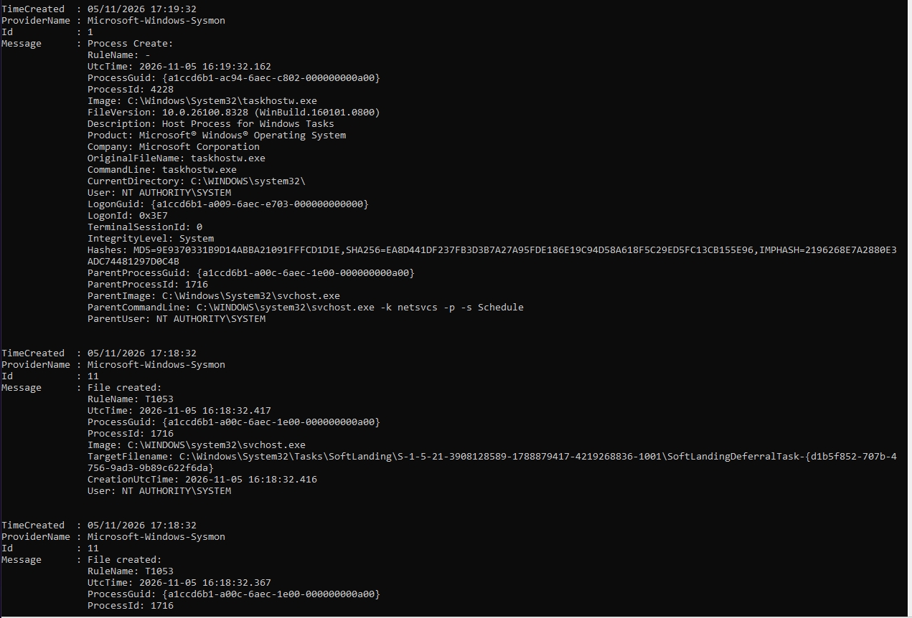
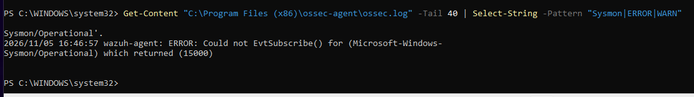
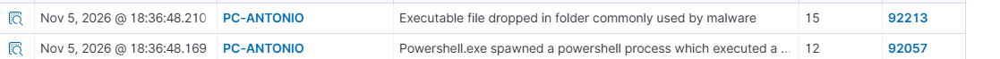

# Detección de actividad en Windows con Sysmon y Wazuh

> **Práctica en laboratorio propio.** Las acciones "maliciosas" las provoqué yo mismo en una máquina virtual aislada para comprobar cómo se detectan desde un SIEM. Las capturas son reales de mi laboratorio.

| Campo | Valor |
|---|---|
| **Herramientas** | Sysmon (Sysinternals), Wazuh 4.14 (SIEM), agente de Wazuh, PowerShell |
| **Equipo vigilado** | Windows 11 Enterprise (agente `PC-ANTONIO`) |
| **Configuración de Sysmon** | `sysmonconfig-export.xml` (SwiftOnSecurity) |
| **Técnicas MITRE simuladas** | Discovery (reconocimiento) · T1059.001 PowerShell |
| **Analista** | SOC nivel 1 |

---

## 1. Objetivo

Mi objetivo era que Wazuh pudiera ver qué programas y comandos se ejecutan en el equipo, quién los lanza, a qué se conectan y qué archivos crean, algo que Windows no registra por defecto. Con esa información, comprobar cómo se detecta en el SIEM la actividad típica de un atacante.

## 2. Qué hice

1. Instalé **Sysmon** desde la web oficial de Microsoft (Sysinternals) con el archivo de configuración `sysmonconfig-export.xml`, descargado de GitHub. Este archivo le indica a Sysmon qué registrar y qué ignorar.
2. Edité el archivo **`ossec.conf`** del agente de Wazuh para que leyera también el registro de Sysmon:

   ```xml
   <localfile>
     <location>Microsoft-Windows-Sysmon/Operational</location>
     <log_format>eventchannel</log_format>
   </localfile>
   ```

3. Reinicié el agente de Wazuh para aplicar el cambio.

El camino de cada evento queda así:

```
Actividad en el equipo → Sysmon la registra → el agente de Wazuh la envía → el servidor la compara con sus reglas → alerta en el panel
```

## 3. Problema encontrado y cómo lo resolví

**Síntoma:** al buscar en Wazuh los eventos de Sysmon de PC-ANTONIO, aparecía *"No results match your search criteria"*.

**Diagnóstico:**

1. Comprobé en Windows con `Get-WinEvent` que Sysmon sí estaba registrando eventos (creación de procesos y de archivos). Así descarté que el problema fuera Sysmon.

   

2. Revisé el log del agente (`ossec.log`) y encontré el error 15000 (*Could not EvtSubscribe*), que indicaba que el agente no podía abrir el registro de Sysmon. El mensaje aparecía partido en dos líneas, y esa fue la pista.

   

**Causa:** en `ossec.conf`, el nombre del registro de Sysmon tenía un salto de línea en medio.

**Solución:** escribí el nombre en una sola línea, reinicié el agente y los eventos empezaron a llegar a Wazuh.

## 4. Pruebas realizadas

Simulé lo que hace un atacante al entrar en un equipo:

**Reconocimiento.** Ejecuté estos comandos para averiguar con qué usuario y privilegios estaba, qué cuentas y administradores había, en qué red estaba el equipo y qué versión de Windows y parches tenía:

| Comando | Qué averigua un atacante |
|---|---|
| `whoami` | Con qué usuario está dentro |
| `whoami /priv` | Qué privilegios tiene ese usuario |
| `net user` | Qué cuentas hay en el equipo |
| `net localgroup Administradores` | Quién es administrador |
| `ipconfig /all` | En qué red está: IP, máscara, puerta de enlace, DNS |
| `systeminfo` | Versión de Windows y parches instalados |

**PowerShell codificado.** Ejecuté un comando inofensivo codificado en Base64:

```
powershell -NoProfile -EncodedCommand VwByAGkAdABlAC0ATwB1AHQAcAB1AHQAIAAnAHAAcgB1AGUAYgBhACAAZABlACAAbABhAGIAbwByAGEAdABvAHIAaQBvACcA
```

Los atacantes codifican sus comandos para que no se entiendan a simple vista y para esquivar reglas que buscan palabras concretas, aunque el propio uso de comandos codificados ya es sospechoso. Para saber qué hacía, lo decodifiqué:

```powershell
[System.Text.Encoding]::Unicode.GetString([Convert]::FromBase64String("VwByAGkAdABlAC0ATwB1AHQAcAB1AHQAIAAnAHAAcgB1AGUAYgBhACAAZABlACAAbABhAGIAbwByAGEAdABvAHIAaQBvACcA"))
# Resultado: Write-Output 'prueba de laboratorio'
```

## 5. Alertas y triaje




| Regla | Nivel | Qué detectó | Qué era en realidad | Clasificación |
|---|---|---|---|---|
| 92031 | 3 | Comandos de reconocimiento | Mis pruebas: `whoami`, `net user`, etc. | Verdadero positivo benigno |
| 92057 | 12 | PowerShell que ejecuta un comando codificado en Base64 | Mi comando de prueba (`Write-Output`), lanzado desde una consola de PowerShell | Verdadero positivo benigno |
| 92213 | 15 | Ejecutable dejado en una carpeta usada por malware | Archivo `__PSScriptPolicyTest_*.ps1` que PowerShell crea en `Temp` cada vez que se abre, para comprobar la política de ejecución | Falso positivo |

- **Verdadero positivo benigno:** la regla acertó, porque la actividad ocurrió, pero estaba autorizada (prueba hecha por mí).
- **Falso positivo:** la regla se equivocó: lo que detectó como malware era un comportamiento normal de Windows.

La alerta 92213 saltaría cada vez que alguien abre PowerShell en cualquier equipo. En un SOC real habría que ajustar la regla con una excepción para el nombre `__PSScriptPolicyTest_`, sin dejar de vigilar otros scripts en `Temp`.

Durante la práctica aparecieron otras alertas (92205 y 92066) coincidiendo con el reinicio del agente. Mi hipótesis es que las generó la revisión automática de configuración del propio agente de Wazuh; quedan pendientes de confirmar subiendo por el árbol de procesos.

## 6. Lecciones aprendidas

- Con Sysmon puedo **registrar** qué programas y comandos se ejecutan en un equipo y quién los lanza, algo que Windows no apunta por defecto. Wazuh muestra esa información junto al programa padre, lo que permite subir por el árbol de procesos hasta el origen.
- Un simple salto de línea en un archivo de configuración puede dejar sin datos al SIEM. El log del agente indicó el error exacto y me llevó a la causa.
- Una alerta de nivel 15 no significa que haya un ataque: en este caso era un archivo temporal que PowerShell crea automáticamente al abrirse. Hay que revisar los detalles antes de decidir y, si se repite, ajustar la regla.
- Un comando codificado no se puede valorar sin decodificarlo primero.
- Falso positivo o verdadero positivo no depende de quién hizo la acción, sino de si la regla acertó: mis pruebas fueron verdaderos positivos benignos.
