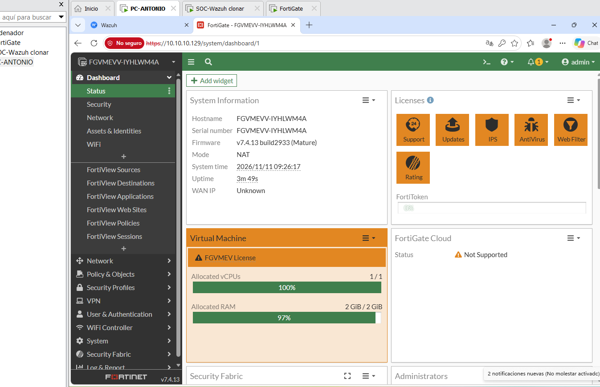
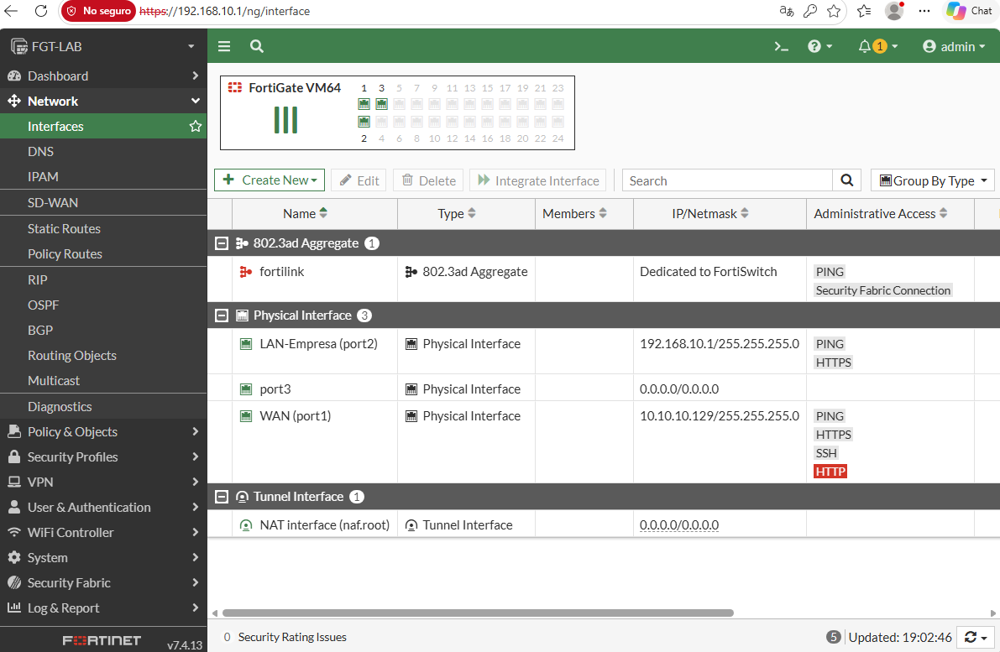
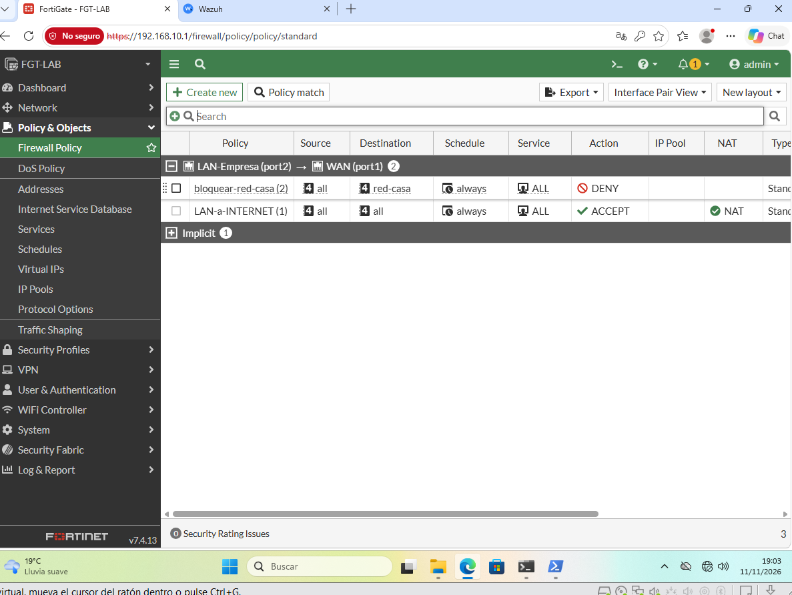
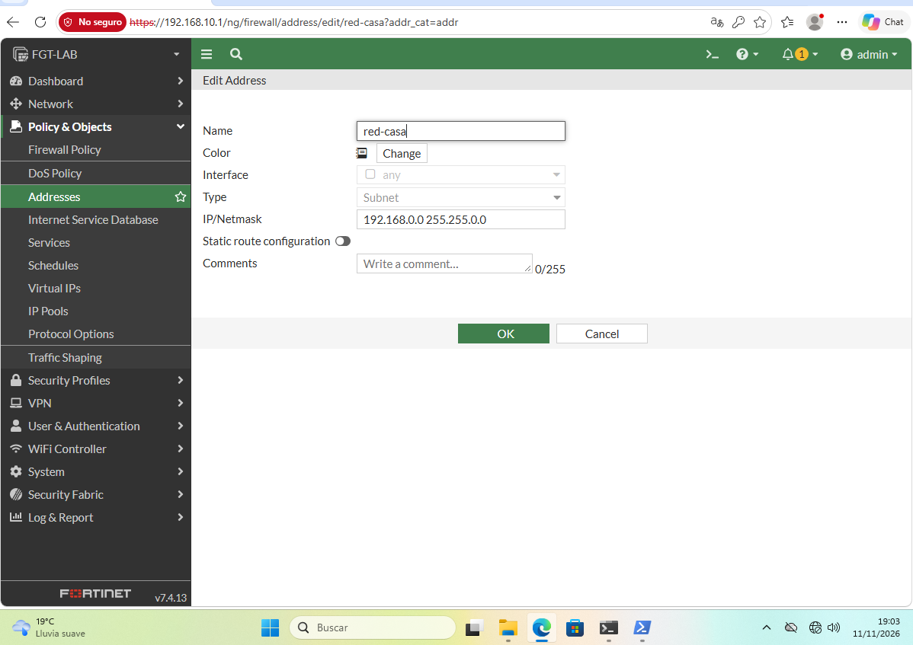
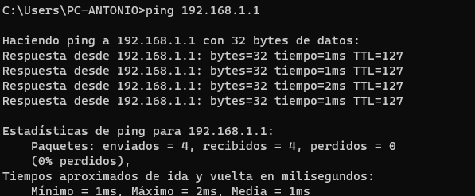
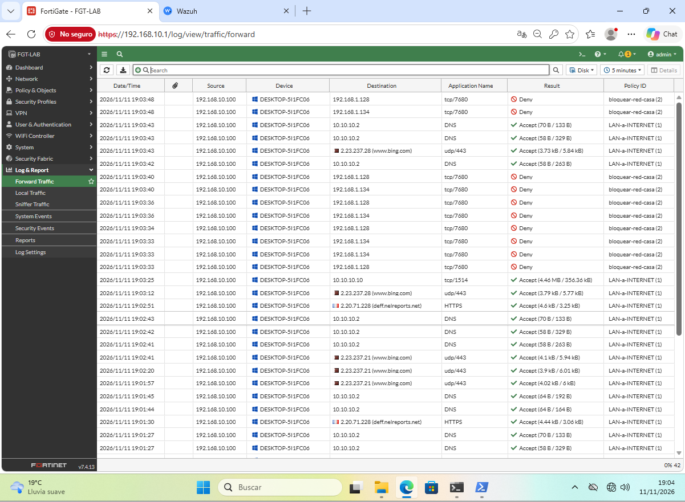
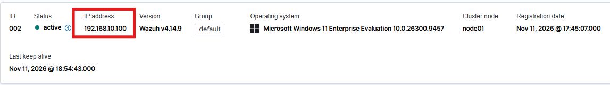

# Firewall perimetral con FortiGate: segmentación, NAT y aislamiento de red

> **Práctica en laboratorio propio.** Monté un FortiGate virtual protegiendo un equipo de "oficina", configuré sus políticas y comprobé su funcionamiento con pruebas reales y con los logs del firewall. Las capturas son reales de mi laboratorio.

| Campo | Valor |
|---|---|
| **Firewall** | FortiGate-VM 7.4.13 (Mature), licencia de prueba permanente |
| **Virtualización** | VMware Workstation (laboratorio migrado desde VirtualBox) |
| **Equipos** | `FGT-LAB` (firewall), `PC-ANTONIO` (Windows 11), `soc-wazuh` (Wazuh 4.14) |
| **Conceptos** | Interfaces WAN/LAN, DHCP, políticas de firewall, NAT, denegación implícita, segmentación, análisis de logs |
| **Analista** | Técnico de seguridad perimetral / SOC nivel 1 |

---

## 1. Objetivo

Colocar un firewall entre el equipo de un empleado y el resto de redes, como en una oficina real: que todo el tráfico de entrada y salida pase por él, que solo se permita lo que una política autoriza, y que quede registrado para poder analizarlo.

## 2. Topología

```
Internet
   │
Red NAT de VMware (10.10.10.0/24) ── Wazuh (10.10.10.10)
   │
port1 = WAN (10.10.10.129, DHCP)
[ FortiGate FGT-LAB ]
port2 = LAN-Empresa (192.168.10.1)
   │
Segmento LAN-Empresa (192.168.10.0/24)
   │
PC-ANTONIO (192.168.10.100, por DHCP del FortiGate)
```



## 3. Configuración

### Interfaces

| Puerto | Alias | Rol | IP | Acceso administrativo |
|---|---|---|---|---|
| port1 | WAN | WAN | 10.10.10.129/24 (DHCP) | PING, HTTPS, SSH, HTTP (ver apartado 7) |
| port2 | LAN-Empresa | LAN | 192.168.10.1/24 | PING, HTTPS |

En `port2` activé un **servidor DHCP** con el rango `192.168.10.100 – 192.168.10.200`, para que los equipos de la oficina reciban su IP, puerta de enlace y DNS del firewall.



### Políticas

El FortiGate aplica las políticas **de arriba abajo** y se queda con la primera que coincide. Lo que no coincide con ninguna cae en la **denegación implícita** del final.

| Orden | Política | Origen → Destino | Acción | NAT | Registro |
|---|---|---|---|---|---|
| 1 | `bloquear-red-casa` | LAN-Empresa → WAN, destino `red-casa` (192.168.0.0/16) | DENY | — | Tráfico denegado |
| 2 | `LAN-a-INTERNET` | LAN-Empresa → WAN, destino `all` | ACCEPT | Sí | Todas las sesiones |
| — | Implicit | Todo lo demás | DENY | — | — |





## 4. Pruebas realizadas

| Prueba | Resultado esperado | Resultado |
|---|---|---|
| Desde PC-ANTONIO, ping al firewall (`192.168.10.1`) sin ninguna política creada | Responde | ✅ Responde |
| Ping a Wazuh (`10.10.10.10`) y a `google.com` sin ninguna política creada | Bloqueado por la denegación implícita | ✅ Bloqueado |
| Los mismos ping con la política `LAN-a-INTERNET` | Permitido | ✅ Permitido |
| Agente de Wazuh de PC-ANTONIO a través del firewall | Sigue activo | ✅ Activo |
| Ping desde PC-ANTONIO a la red de mi casa con la política de bloqueo | Bloqueado | ✅ Bloqueado (tras corregir la regla, apartado 5) |
| Ping a `google.com` con la política de bloqueo | Permitido | ✅ Permitido |

## 5. Problema encontrado y cómo lo resolví

**Síntoma:** con la política de bloqueo creada, PC-ANTONIO seguía haciendo ping a `192.168.1.1`.



**Diagnóstico:** revisé el orden de las políticas (correcto) y la configuración del objeto de destino. Al comprobar la red de mi casa con `ipconfig` en el equipo anfitrión, vi que era `192.168.128.x`, no `192.168.1.x`. La red `192.168.1.x` pertenece al router de la compañía, situado delante del mío.

**Causa:** el objeto apuntaba a `192.168.1.0/24`. La regla estaba bien construida, pero aplicada a la red equivocada, y además había dos redes domésticas que aislar.

**Solución:** amplié el objeto a `192.168.0.0/16`, que cubre las dos redes. No afecta a la oficina, porque la política solo se aplica al tráfico que sale por la WAN, ni a Wazuh, que está en `10.10.10.x`. Después repetí las pruebas: el ping a la red de casa queda bloqueado e internet sigue funcionando.

## 6. Análisis de los logs



| Destino | Servicio | Política | Interpretación |
|---|---|---|---|
| `10.10.10.10` | tcp/1514 | LAN-a-INTERNET | Agente de Wazuh enviando eventos al servidor a través del firewall |
| `10.10.10.2` | DNS | LAN-a-INTERNET | Consultas DNS a la puerta de enlace de la red NAT |
| `www.bing.com` | udp/443 | LAN-a-INTERNET | Navegación web sobre QUIC |
| `192.168.1.128`, `192.168.1.134` | tcp/7680 | **bloquear-red-casa** (Deny) | Optimización de distribución de Windows buscando otros equipos de la red doméstica para compartir actualizaciones |

Los intentos por el puerto 7680 fueron los que revelaron que el laboratorio llegaba a mi red doméstica, antes de crear la política de bloqueo.

## 7. Qué IP ve cada herramienta con NAT



| Quién mira | IP que ve de PC-ANTONIO |
|---|---|
| Wazuh (el agente informa de su propia IP) | `192.168.10.100` |
| Logs del FortiGate | La original (`192.168.10.100`) y la traducida (`10.10.10.129`) |
| Cualquier otro servidor al que se conecte | Solo `10.10.10.129`, la del firewall |

En una investigación, si un servidor registra una conexión desde la IP del firewall, hay que acudir a los logs de NAT del FortiGate para identificar el equipo interno real.

## 8. Hallazgos y mejoras

- **Hora del firewall:** los primeros logs aparecían con 9 horas de diferencia, porque el FortiGate venía con la zona horaria de la costa oeste de EE. UU. La corregí a Madrid con sincronización NTP. Sin relojes sincronizados, no se pueden correlacionar los logs del firewall con los del SIEM.
- **Acceso administrativo en la WAN:** el puerto `port1` tenía activado **HTTP** (marcado en rojo por el propio FortiGate como inseguro, porque envía las credenciales sin cifrar) y SSH. **Lo corregí** desactivando HTTP y SSH en la WAN, y dejando solo PING y HTTPS. La captura de interfaces del apartado 3 es anterior a la corrección.

## 9. Lecciones aprendidas

- Un firewall bloquea todo por defecto: solo pasa lo que una política permite expresamente (denegación implícita).
- El orden de las políticas importa: se aplica la primera que coincide, por eso los bloqueos van encima de las reglas generales.
- Una regla bien escrita puede no servir si apunta a la red equivocada: toda regla nueva se prueba antes de darla por buena.
- Los logs del firewall cuentan lo que pasa en la red: gracias a ellos descubrí que el laboratorio llegaba a mi red doméstica.
- Con NAT, cada herramienta puede ver una IP distinta del mismo equipo, y hay que saber dónde buscar la IP real.
