# Logs del firewall en el SIEM: FortiGate → Wazuh por syslog y detección de fuerza bruta

> **Práctica en laboratorio propio.** Envié los logs de un FortiGate a Wazuh, resolví por qué no generaban alertas y simulé un ataque de fuerza bruta contra la administración del firewall para investigarlo como analista. Las capturas son reales de mi laboratorio.

| Campo | Valor |
|---|---|
| **Herramientas** | FortiGate-VM 7.4.13, Wazuh 4.14 (SIEM), tcpdump, wazuh-logtest |
| **Equipos** | `FGT-LAB` (firewall), `soc-wazuh1` (Wazuh, Ubuntu Server 24.04), `PC-ANTONIO` (Windows 11) |
| **Técnica MITRE simulada** | T1110.001 Brute Force: Password Guessing |
| **Conceptos** | Syslog, decodificadores y reglas de Wazuh, niveles de alerta, diagnóstico por capas, triaje |
| **Analista** | SOC nivel 1 |

Este caso continúa el [caso 5](../05-fortigate-perimetral), donde monté el FortiGate y sus políticas.

---

## 1. Objetivo

Hasta ahora Wazuh solo veía lo que pasaba dentro de los equipos, a través de sus agentes. Un firewall no admite agentes, pero es el aparato que ve todo el tráfico de la red y protege su propia administración. El objetivo era llevar sus logs al SIEM para tener en un solo sitio lo que pasa en los equipos y en la red, y comprobar que un ataque contra el firewall se detecta.

## 2. Arquitectura

```
PC-ANTONIO (192.168.10.100)
   │  agente de Wazuh ──────────────► tcp/1514 ─┐
   │                                            │
[ FortiGate FGT-LAB ]                           ▼
   port1 WAN (10.10.10.129) ── syslog udp/514 ─► Wazuh (10.10.10.10)
```

- **Agentes** (PC-ANTONIO): canal cifrado por **TCP 1514**.
- **Firewall**: no lleva agente; envía sus logs por **syslog**, **UDP 514**. Wazuh los muestra como eventos del propio servidor (`soc-wazuh1`), con la IP del firewall en el campo `location`.

## 3. Configuración

**FortiGate.** En *Log & Report > Log Settings* activé el envío por syslog al servidor `10.10.10.10`.

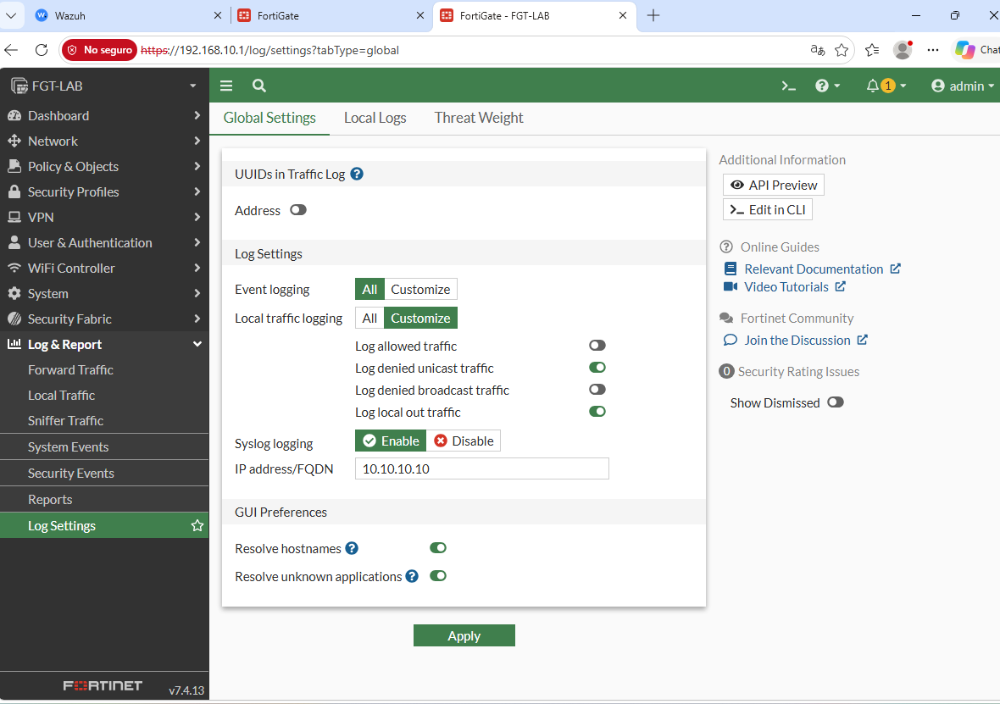

**Wazuh.** En `/var/ossec/etc/ossec.conf`, un bloque `<remote>` para cada canal:

```xml
<!-- Agentes -->
<remote>
  <connection>secure</connection>
  <port>1514</port>
  <protocol>tcp</protocol>
  <queue_size>131072</queue_size>
</remote>

<!-- Syslog del FortiGate -->
<remote>
  <connection>syslog</connection>
  <port>514</port>
  <protocol>udp</protocol>
  <allowed-ips>10.10.10.0/24</allowed-ips>
  <local_ip>10.10.10.10</local_ip>
</remote>
```

`allowed-ips` limita qué equipos pueden enviar syslog: Wazuh descarta los mensajes que llegan de cualquier otra red.

## 4. Comprobación de la llegada

Con `tcpdump` comprobé que los mensajes del FortiGate llegaban a la tarjeta de red del servidor: 47 mensajes en un minuto, solo con la actividad normal de un equipo.

```
sudo tcpdump -i ens33 udp port 514
```

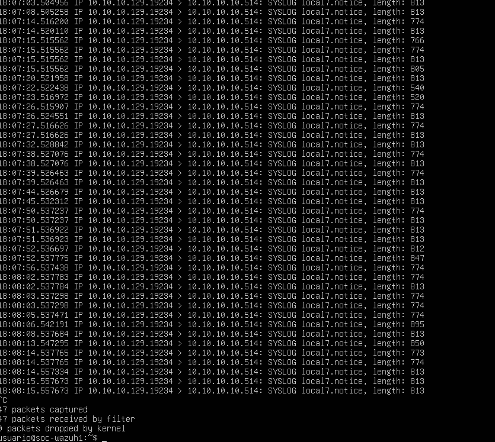

El servidor Ubuntu está en hora UTC (una hora menos que Madrid). Hay que tenerlo en cuenta al comparar horas de distintas fuentes.

## 5. Simulación de fuerza bruta

Desde PC-ANTONIO intenté entrar en la web de administración del firewall (`https://192.168.10.1`) con el usuario `admin` y contraseñas incorrectas.

Al tercer fallo, el FortiGate bloqueó la IP durante 60 segundos:

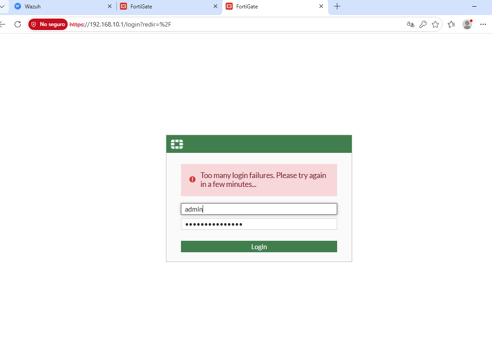

Así se ven los logs en bruto, capturados con `tcpdump -A` para leer su contenido:

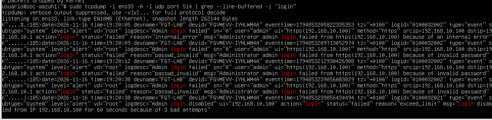

| Campo | Valor | Significado |
|---|---|---|
| `logdesc` | `Admin login failed` | Intento fallido de entrar como administrador |
| `user` | `admin` | Usuario utilizado |
| `srcip` → `dstip` | `192.168.10.100` → `192.168.10.1` | Desde PC-ANTONIO contra el propio firewall |
| `method` | `https` | Por la web de administración |
| `reason` | `passwd_invalid` | Contraseña incorrecta |

La última línea es el bloqueo: `Admin login disabled`, `reason="exceed_limit"`, *Login disabled from IP 192.168.10.100 for 60 seconds because of 3 bad attempts*. Con 3 intentos por minuto, adivinar una contraseña robusta llevaría años.

## 6. Problema encontrado: los logs llegaban, pero no había alertas

**Síntoma:** en el panel de Wazuh no aparecía ninguna alerta del FortiGate, ni siquiera de los inicios de sesión fallidos.

```
sudo grep -c "Admin login failed" /var/ossec/logs/alerts/alerts.json
0
```

**Diagnóstico por capas.** Fui descartando cada paso del camino del log:

| Paso | Comprobación | Resultado |
|---|---|---|
| 1. ¿Llega a la red? | `tcpdump` | ✅ Sí, desde `10.10.10.129` al puerto 514 |
| 2. ¿Wazuh entiende el formato? | `wazuh-logtest` con un log real | ✅ Sí, decodificador `fortigate-firewall-v5` |
| 3. ¿Alguna regla lo convierte en alerta? | `wazuh-logtest` | ✅ Sí, regla 81606, nivel 4: *Alert to be generated* |
| 4. ¿Wazuh lo está recibiendo? | Log de `wazuh-remoted` y `ossec.conf` | ❌ **No** |

Para el paso 2 guardé un log real en un archivo y se lo pasé al simulador de Wazuh, que muestra qué haría con él:

```
sudo tcpdump -i ens33 -A -l udp port 514 2>/dev/null | grep -m 1 -o 'date=.*Admin login failed.*' > ~/fgt.log
sudo /var/ossec/bin/wazuh-logtest < ~/fgt.log
```

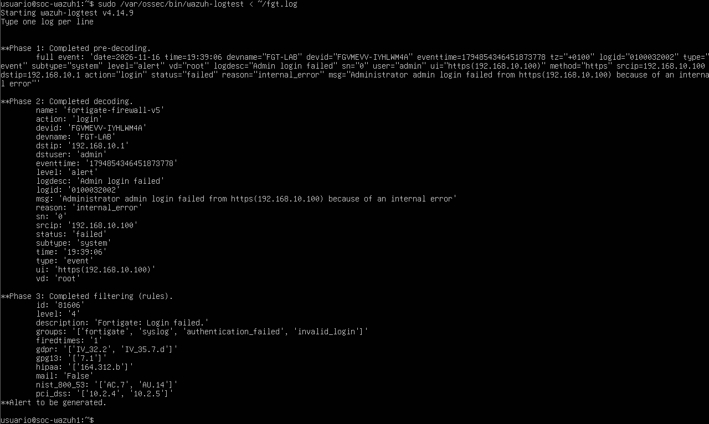

Con el formato y la regla descartados, el problema tenía que estar en la recepción. El log de `wazuh-remoted` mostraba que, desde el cambio de configuración, el canal de los agentes escuchaba por **`1514/UDP`** en lugar de TCP, y que **no se había abierto ningún canal syslog**:

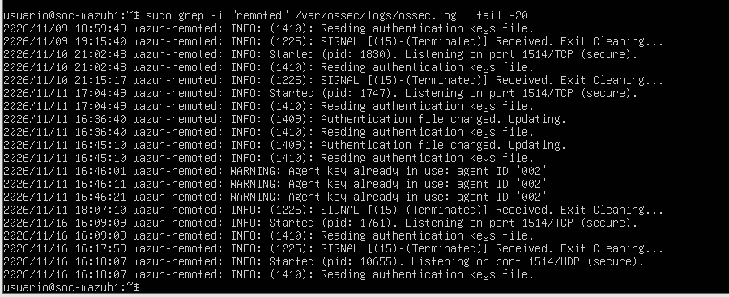

**Causa:** al añadir la configuración del syslog, sus líneas quedaron **dentro del bloque de los agentes** en lugar de en un bloque propio. El resultado era un único `<remote>` mezclado: el canal de los agentes pasó a UDP y el canal syslog no existía.

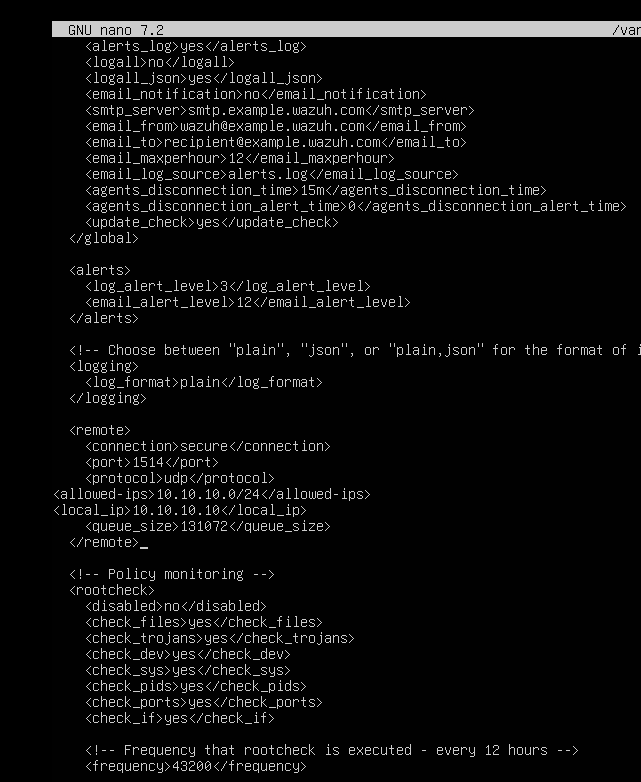

**Un error mío durante la revisión.** Al principio había comprobado con `ss -lunp | grep 514` que Wazuh "escuchaba en el 514". En realidad estaba escuchando en el **1514**: `grep 514` también coincide con `1514`. La forma correcta es buscar `":514 "`, con los dos puntos y el espacio.

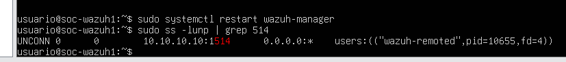

**Un segundo problema.** Durante el diagnóstico, al editar de nuevo `ossec.conf`, se borró parte de una IP y Wazuh dejó de arrancar. El log lo indicaba exactamente: `Invalid ip address: '10.10.10.'` y un error `CRITICAL`, que detiene el servicio.

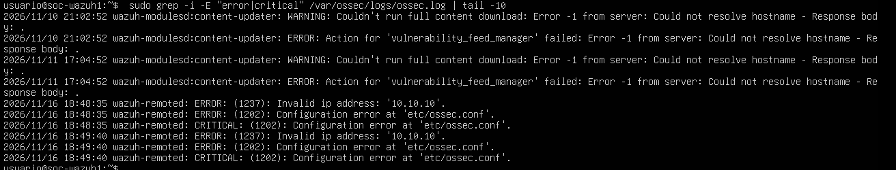

**Solución:** corregí la IP y separé la configuración en los dos bloques del apartado 3. Tras reiniciar, aparecieron **dos procesos `wazuh-remoted`** (uno por canal), el agente de PC-ANTONIO volvió a enviar eventos y los fallos de login empezaron a generar alertas:

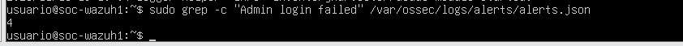

## 7. Alertas y triaje

Repetí la prueba de fuerza bruta con todo funcionando:

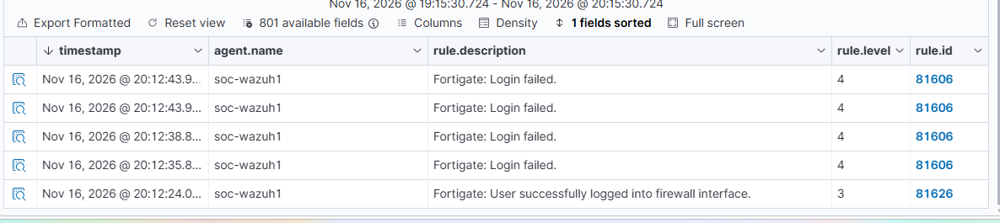

| Hora | Regla | Nivel | Qué detectó |
|---|---|---|---|
| 20:12:24 | 81626 | 3 | Inicio de sesión correcto en el firewall |
| 20:12:35 – 20:12:43 | 81606 | 4 | 4 inicios de sesión fallidos |

Lo primero que comprobé fue **el orden**. Un inicio de sesión correcto **después** de varios fallos es la señal de una fuerza bruta con éxito. Aquí el inicio correcto fue **antes**, y al revisarlo resultó ser un acceso por **consola**:

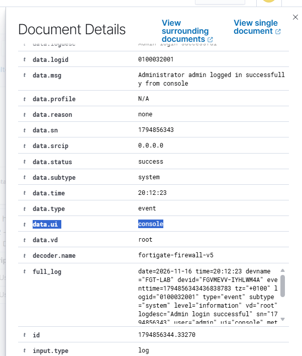

| Campo | Valor | Significado |
|---|---|---|
| `ui` | `console` | Consola local del firewall, no la red |
| `srcip` | `0.0.0.0` | Sin IP de origen, porque no pasa por la red |
| `msg` | *Administrator admin logged in successfully from console* | La cuenta de administrador `admin` entró por la consola |

### Nota de cierre 1

> **Alerta:** Fortigate: User successfully logged into firewall interface (regla 81626, nivel 3).
> **Equipo/usuario:** firewall FGT-LAB, usuario `admin`, acceso por consola local (`srcip` 0.0.0.0).
> **Qué se observó:** inicio de sesión correcto el 16/11/2026 a las 20:12:24.
> **Verificación:** el administrador del firewall confirma que fue él, desde la consola de la máquina virtual en VMware.
> **Clasificación:** verdadero positivo benigno (acceso autorizado).
> **Acción:** cerrado sin más acciones.

### Nota de cierre 2

> **Alerta:** Fortigate: Login failed (regla 81606, nivel 4), 4 alertas.
> **Equipo/usuario:** firewall FGT-LAB, usuario `admin`, por la web de administración (`https`) desde `192.168.10.100` (PC-ANTONIO).
> **Qué se observó:** 4 intentos fallidos entre las 20:12:35 y las 20:12:43. El FortiGate bloqueó la IP durante 60 segundos tras 3 fallos, pero ese bloqueo no generó alerta en Wazuh. No hubo ningún inicio de sesión correcto desde esa IP después de los fallos.
> **Verificación:** prueba de fuerza bruta autorizada, realizada en el laboratorio.
> **Clasificación:** verdadero positivo benigno.
> **Acción:** cerrado. Mejora propuesta: crear una regla para el bloqueo por intentos fallidos.

## 8. Hallazgos y mejoras

- **El bloqueo no genera alerta.** El FortiGate registra *Admin login disabled* cuando bloquea una IP por fuerza bruta, pero en Wazuh no aparece ninguna alerta. Es más grave que un fallo suelto y, sin embargo, no se ve. **Mejora pendiente:** crear una regla propia en `local_rules.xml` que lo detecte con nivel alto.
- **Sin alerta de "muchos fallos".** Igual que en el [caso 3](../03-deteccion-windows-wazuh), 4 fallos no alcanzan el umbral de la regla que agrupa intentos repetidos.
- **El nivel no siempre refleja la gravedad.** Un inicio de sesión por consola tiene nivel 3, pero en una empresa real exige estar en el CPD o tener acceso al hipervisor. Si nadie lo reconoce, es de las alertas más graves. El contexto lo pone el analista.
- **Registro completo desactivado.** Durante el diagnóstico activé `logall_json`, que guarda todos los eventos recibidos aunque no generen alerta. Lo volví a desactivar al terminar, porque ese archivo crece muy rápido.

## 9. Lecciones aprendidas

- Un SIEM recibe muchos más logs de los que muestra: solo crea alertas con los que coinciden con una regla de nivel 3 o más.
- Ante "no llegan alertas", hay que revisar el camino paso a paso: red, formato, regla y recepción. Así el problema se acota en lugar de adivinarlo.
- `wazuh-logtest` permite probar un log real sin esperar a que se repita el ataque.
- Un error en un archivo de configuración puede dejar sin datos al SIEM, o parar el servicio entero. El log del propio servicio indica dónde está el fallo.
- Hay que comprobar exactamente lo que dice una salida: `grep 514` también encuentra `1514`.
- En una fuerza bruta, lo primero es comprobar si el atacante acabó entrando: si hay un inicio de sesión correcto después de los fallos, ya no es un intento, es una intrusión.
